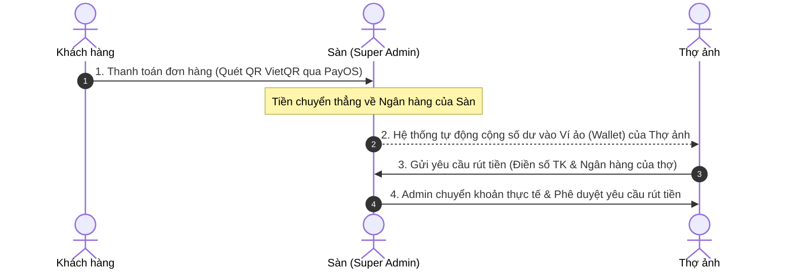

# MÔ HÌNH THANH TOÁN & RÚT TIỀN (CENTRALIZED ESCROW & PAYOUT) - AURASHOT

Tài liệu này giải thích chi tiết cơ chế hoạt động của dòng tiền, cách tích hợp cổng PayOS duy nhất và quy trình thợ ảnh (Photographer) liên kết tài khoản ngân hàng để nhận doanh thu trên hệ sinh thái AuraShot.

---

## I. KIẾN TRÚC DÒNG TIỀN (MONEY FLOW ARCHITECTURE)

Hệ thống AuraShot áp dụng mô hình **Sàn thu hộ & Rút tiền (Centralized Escrow)** giống như Shopee, Lazada hay các nền tảng thương mại điện tử lớn khác. 

Mô hình này giúp thợ ảnh đơn giản hóa tối đa quy trình nhận tiền: **họ không cần phải tự tạo tài khoản cổng thanh toán PayOS hay tích hợp API phức tạp**, chỉ cần cung cấp số tài khoản ngân hàng cá nhân thông thường.

---

## II. QUY TRÌNH VẬN HÀNH CHI TIẾT

### Bước 1: Photographer cấu hình thông tin nhận tiền
Khi đăng ký tài khoản và thiết lập gian hàng, Photographer sẽ truy cập vào phần **Cấu hình tài khoản** trên giao diện cá nhân và nhập thông tin tài khoản ngân hàng nhận tiền thực tế:
*   **Tên ngân hàng:** (Ví dụ: *ACB, Vietcombank, Techcombank...*)
*   **Số tài khoản ngân hàng:** (Ví dụ: *34251757*)
*   **Tên chủ tài khoản:** (Ví dụ: *VU TIEN DAT*)

> [!NOTE]  
> Các thông tin này sẽ được lưu trữ vào cơ sở dữ liệu MongoDB trong collection `PhotographerProfile` của thợ ảnh để phục vụ việc đối chiếu khi rút tiền.

### Bước 2: Khách hàng mua sản phẩm & thanh toán
Khi khách hàng mua ảnh hoặc dịch vụ từ một Photographer:
1.  Hệ thống sử dụng cấu hình tài khoản PayOS duy nhất của **Sàn (Admin)** để tạo link thanh toán VietQR động.
2.  Khách hàng quét mã QR để chuyển khoản. Tiền sẽ chảy từ tài khoản ngân hàng của khách hàng vào thẳng **tài khoản ngân hàng của Sàn (Admin)**.

### Bước 3: Tự động ghi nhận doanh thu vào Ví ảo (Wallet)
Ngay khi giao dịch thành công:
1.  PayOS gửi tín hiệu xác thực (Webhook) về máy chủ của hệ thống.
2.  Hệ thống cập nhật trạng thái đơn hàng thành `completed`.
3.  Hệ thống tự động tìm ví điện tử ảo của Photographer sở hữu sản phẩm đó và **cộng dồn doanh thu tương ứng** vào số dư ví (`balance`).
4.  Photographer có thể theo dõi biến động số dư và doanh thu tức thì tại màn hình thống kê doanh số.

### Bước 4: Tạo yêu cầu rút tiền thực tế (Withdrawal Request)
Khi Photographer muốn rút tiền mặt tích lũy trong ví ảo về tài khoản ngân hàng thực tế của họ:
1.  Họ thực hiện tạo lệnh rút tiền trên Dashboard của mình bằng cách nhập số tiền cần rút.
2.  Hệ thống tự động lấy thông tin tài khoản ngân hàng đã thiết lập ở **Bước 1** để điền vào yêu cầu, khóa tạm thời số dư ví tương ứng và tạo bản ghi yêu cầu rút tiền (`WithdrawalRequest`) gửi lên admin ở trạng thái `pending`.

### Bước 5: Admin thực hiện giao dịch ngân hàng ngoài đời thực
1.  Chủ sàn (Admin) đăng nhập vào trang quản trị quản lý danh sách các yêu cầu rút tiền đang chờ duyệt.
2.  Admin kiểm tra thông tin số tài khoản của thợ ảnh (ví dụ: *VU TIEN DAT - ACB - 34251757*) và sử dụng app ngân hàng cá nhân của mình để **chuyển khoản thực tế** số tiền tương ứng cho thợ ảnh.
3.  Sau khi chuyển tiền thành công, Admin bấm **Phê duyệt (Approve)** trên trang quản trị. Trạng thái yêu cầu rút tiền chuyển thành `approved`, hoàn tất quy trình thanh toán của hệ thống.

---

## III. SO SÁNH HAI MÔ HÌNH VẬN HÀNH

| Tiêu chí | Mô hình Sàn thu hộ (Đang áp dụng) | Mô hình Thợ ảnh nhận trực tiếp |
| :--- | :--- | :--- |
| **Tài khoản PayOS** | Chỉ cần **01** tài khoản duy nhất của Sàn (Admin) cấu hình trong Backend. | Mỗi thợ ảnh phải có **01** tài khoản PayOS riêng và cấu hình API key cá nhân. |
| **Quy trình của Thợ ảnh** | Rất đơn giản: Chỉ cần điền Số tài khoản ngân hàng thường. | Phức tạp: Phải đăng ký tài khoản đối tác PayOS, lấy client_id, api_key. |
| **Thu phí / Hoa hồng** | Admin tự động khấu trừ hoa hồng trực tiếp trên từng đơn hàng trước khi cộng vào ví thợ ảnh. | Phải cấu hình các gói đăng ký định kỳ (SaaS Package) để thu phí thuê bao thợ ảnh hàng tháng. |
| **Quản lý dòng tiền** | Admin nắm giữ dòng tiền và chủ động phân phối qua lệnh rút tiền. | Tiền chảy trực tiếp vào tài khoản thợ ảnh, Admin không giữ tiền. |
| **Phù hợp với** | Các dự án xây dựng theo hướng sàn giao dịch, marketplace (giống Shopee). | Các dự án làm phần mềm quản lý cho thuê dạng SaaS thuần túy (giống Shopify). |

---

